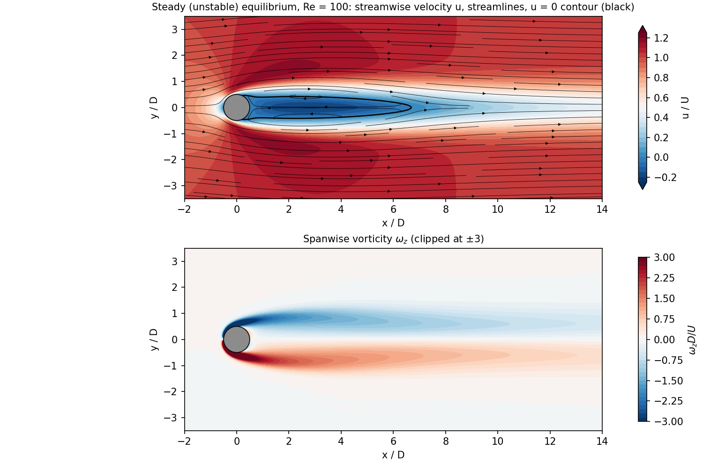
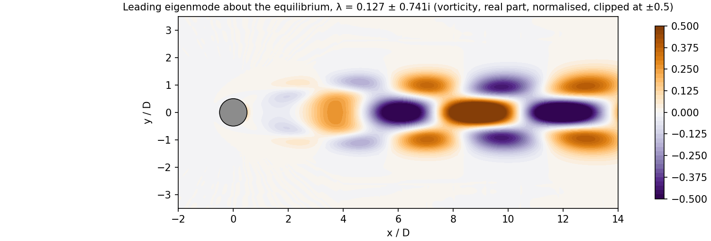
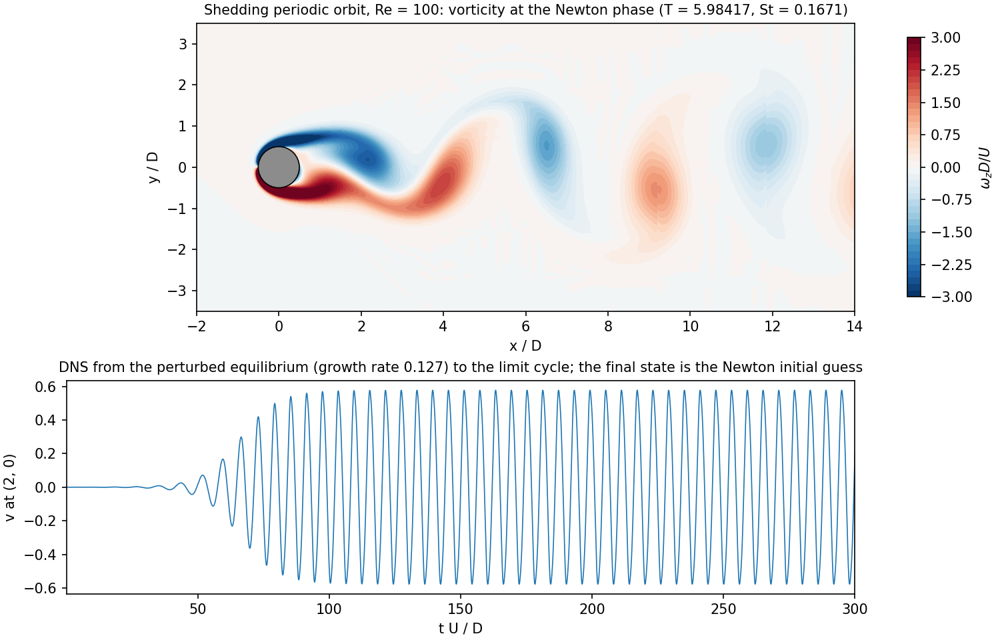
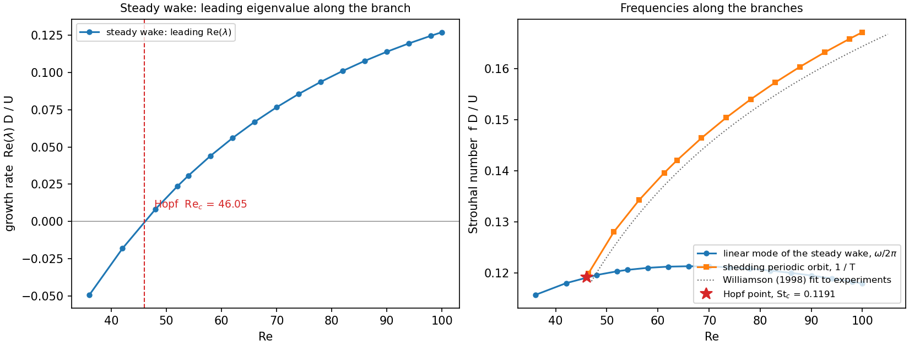

# nekecs

Exact coherent structures of the incompressible Navier–Stokes equations in
complex geometries. nekecs finds **equilibria** (steady states, stable or
unstable) and **periodic orbits**, computes their **stability**, and follows
them in a **parameter** such as the Reynolds number or an inflow angle. It
runs Newton–Krylov iterations with a hookstep trust region around the flow
map of the [Nektar++](https://www.nektar.info) spectral/hp time-stepper, so
any mesh Nektar++ can run works. The approach is the one of ECSAct (Dedalus)
and Channelflow's `findsoln`, moved from periodic boxes to unstructured meshes.

| Capability | Status |
|---|---|
| Equilibria (EQ) | working |
| Periodic orbits (PO) | working |
| Linear stability (EQ) / Floquet multipliers (PO) | working |
| Continuation in Re, or in any parameter that enters the boundary conditions (inflow angle, rotation rate, ...) | working; fold-following, stability changes reported |
| Continuation in geometric parameters (gap ratio, ...) | planned (needs a parametrised mesh family) |

## Contents

- [Example: cylinder wake at Re = 100](#example-cylinder-wake-at-re--100)
- [Example: continuation in Re and the Hopf bifurcation](#example-continuation-in-re-and-the-hopf-bifurcation)
- [Installation](#installation)
- [Running the cylinder example](#running-the-cylinder-example)
- [Using nekecs on your own case](#using-nekecs-on-your-own-case)
- [Repository layout](#repository-layout)

## Example: cylinder wake at Re = 100

### The unstable steady wake (equilibrium)

Above Re ≈ 47 the steady wake is unstable, so time stepping cannot reach it.
nekecs converges to it in **4 Newton steps** (about 4 min on one core):

| Newton step | 0 | 1 | 2 | 3 | 4 |
|---|---|---|---|---|---|
| ‖Φ_T(u) − u‖ / ‖u‖ | 6.7e-5 | 2.1e-6 | 3.8e-8 | 6.1e-10 | **1.0e-11** |



Checks that do not use the Newton solver:

- **Invariance:** ‖Φ_kT(u) − u‖ / ‖u‖ = 1.0e-11 … 7.3e-11 for k = 1, 2, 4, 8.
- **Symmetry:** nothing imposes it, yet the centreline cross-stream velocity
  is at most 3.6e-6.
- **Recirculation bubble:** 6.19 D long.
- **Leading eigenvalue:** λ = **0.127049 ± 0.740684i** (unstable, St = 0.118),
  against 0.12709 ± 0.740665i from Nektar++'s own Arnoldi on the linearised
  equations, which carries a small integrator start-up bias.



### Vortex shedding (periodic orbit)

Starting from a short DNS, Newton solves for x = (u_n, u_{n−1}, T) in
**2 steps** (about 4 min):

| | |
|---|---|
| ‖F‖ / ‖x‖ | 6.9e-4 → 1.1e-6 → **5.4e-10** |
| Period | **T = 5.98417083, St = 0.167108** (DNS estimate 5.98416) |
| Closure after 2 periods in one call | 6.6e-10 |
| Floquet multipliers | **1.00000** (time-shift mode, \|μ − 1\| ≈ 2e-7), 0.649, 0.579 ± 0.146i: a stable limit cycle |



## Example: continuation in Re and the Hopf bifurcation

Both solutions above were followed in Re by pseudo-arclength continuation
(`cont_eq.xml`, `cont_po.xml`), with the leading eigenvalue of the steady wake
computed at every point. No step failed on either branch.



- **Steady wake, Re 100 → 36** (18 points): the leading eigenvalue crosses
  the imaginary axis at the Hopf point. Direct solves at Re = 46 and 46.5
  (growth rates −2.2e-4 and +1.9e-3) give **Re_c = 46.05, ω_c = 0.748
  (St_c = 0.119)**. Well-resolved unconfined computations give Re_c = 46.6–46.7
  and ω_c = 0.736–0.74 (Giannetti & Luchini 2007; Sipp & Lebedev 2007); this
  example mesh is deliberately coarse (746 elements, order 5) and lands 1% low.
- **Shedding orbit, Re 100 → 46.4** (13 points): the period grows from 5.98
  to 8.34, and the Strouhal number falls from 0.167 to 0.1199, meeting the
  linear Hopf frequency St_c = 0.1191 at onset, as it must for a
  supercritical Hopf bifurcation. Above onset the nonlinear frequency departs
  quickly from the linear one (0.167 vs 0.118 at Re = 100) and follows
  Williamson's experimental fit, about 1–2% above it as is typical of 2D
  computations.

### Why the flow map is exact

Nektar++'s second-order IMEX scheme is a multistep method. Restarting it at
every flow-map call leaves a start-up error of about 2e-8, larger than the
Newton tolerance. nekecs runs its own stepping loop and keeps the previous
time level u_{n−1} in the state, so every call is exactly N regular steps:
two half-period calls match one full call to 2e-14. Details and all
measurements are in [DESIGN.md](DESIGN.md).

## Installation

nekecs runs on Linux. On Windows, use WSL2 with Ubuntu 24.04; everything
below runs inside it. Tested with Ubuntu 24.04, GCC 13, CMake 3.28 and
Nektar++ v5.10.0.

**1. System packages**

```bash
sudo apt install build-essential gfortran cmake git libboost-all-dev libopenblas-dev liblapack-dev libfftw3-dev libopenmpi-dev openmpi-bin libhdf5-openmpi-dev libarpack2-dev zlib1g-dev python3-numpy python3-matplotlib
```

**2. Nektar++ v5.10.0**, built with its solver libraries (nekecs links the
incompressible solver classes). The script configures, builds and installs
to `~/opt/nektar++`; the build takes about 10 min on 24 cores.

```bash
git clone --branch v5.10.0 --depth 1 https://gitlab.nektar.info/nektar/nektar.git ~/src/nektar
```

```bash
git clone https://github.com/duc-nguyen1410/nekecs.git ~/nekecs && cd ~/nekecs
```

```bash
bash tools/build_nektar.sh ~/src/nektar ~/opt/nektar++
```

The script patches one line of Nektar++'s `solvers/CMakeLists.txt` so that
only the needed solvers are built (this also avoids a v5.10.0 build bug).

**3. nekecs**

```bash
cmake -S . -B ~/build/nekecs -DCMAKE_BUILD_TYPE=Release -DNektar++_DIR=$HOME/opt/nektar++/lib64/nektar++/cmake
```

```bash
cmake --build ~/build/nekecs -j8 && ctest --test-dir ~/build/nekecs
```

`ctest` runs the core tests (GMRES, hookstep, Newton, Arnoldi, continuation
on Lorenz and fold problems; under a second). To try the core alone without
Nektar++, configure with `-DNEKECS_WITH_NEKTAR=OFF`.

## Running the cylinder example

The mesh (746 quadrilaterals, polynomial order 5) and starting fields come
from a Nektar++ regression test. `run_all.sh` creates the run directory and
runs every step in order (about 40 min on one core), skipping steps whose
output already exists:

```bash
bash cases/cyl2d/run_all.sh ~/runs/cyl2d
```

| Step | Session | Output | Time (1 core) |
|---|---|---|---|
| Equilibrium + leading eigenvalues | `session.xml` | `session_eq.fld` | ~10 min |
| Nektar++ Arnoldi cross-check | `stability.xml` | `mesh_eig_0.fld` | ~2 min |
| DNS from the equilibrium to the shedding cycle | `shed.xml` | `shed_shed.fld`, `shed_probe.dat` | ~10 min |
| Shedding periodic orbit + Floquet multipliers | `po.xml` | `po_po.fld` | ~15 min |
| Continuation in Re (with `--continuation`) | `cont_eq.xml`, `cont_po.xml` | `cont_*_branch.dat` | hours |

Then make the figures (vorticity and grid interpolation with FieldConvert,
plots with matplotlib):

```bash
bash tools/make_cyl2d_figures.sh ~/runs/cyl2d docs/figures
```

and, after `--continuation`, the bifurcation diagram (add `--hopf RE_C OMEGA_C`
to mark a Hopf point refined by direct solves; otherwise it is interpolated
along the branch):

```bash
python3 tools/plot_branch.py docs/figures --eq ~/runs/cyl2d/cont_eq_branch.dat --po ~/runs/cyl2d/cont_po_branch.dat
```

Each step can also be run on its own from the run directory, for example
`~/build/nekecs/nekecs mesh.xml.gz session.xml`. Set
`OPENBLAS_NUM_THREADS=1` first (`run_all.sh` does): multithreaded OpenBLAS is
about 8× slower on the small element matrices.

## Using nekecs on your own case

nekecs reads an ordinary Nektar++ incompressible session file plus a few
`ECS_*` parameters:

```bash
~/build/nekecs/nekecs mesh.xml session.xml
```

**Session requirements:** `SolverType = VelocityCorrectionScheme`, IMEX time
integration of order 2, variables `u, v[, w], p`. The initial condition is
the Newton initial guess: a nearly steady field for an equilibrium, a
snapshot from a DNS of the saturated oscillation for a periodic orbit (`shed`
produces one).

**Problem type:** `ECS_Period = 0` (default) finds an equilibrium, with the
residual Φ_T(u) − u over T = `ECS_Steps` × `TimeStep`. `ECS_Period > 0` finds
a periodic orbit, with the value as the initial period guess and
`ECS_Steps` steps per period.

**Continuation:** add `<I PROPERTY="ECS_ContParam" VALUE="Re"/>` to
`SOLVERINFO`. The parameter is `Re` (the session must define `Re`; Kinvis
becomes 1/Re), `Kinvis`, or any session parameter that appears **directly**
in a boundary-condition expression, written exactly as in the session, e.g.
an inflow angle:

```xml
<P> AoA = 0.0 </P>
...
<D VAR="u" VALUE="cos(AoA)"/>
<D VAR="v" VALUE="sin(AoA)"/>
```

**Main parameters** (all are listed in the header of
[apps/nekecs.cpp](apps/nekecs.cpp)):

| Parameter | Meaning | Default |
|---|---|---|
| `ECS_Steps` | time steps per flow-map call (per period for POs) | 100 |
| `ECS_Period` | 0: equilibrium; > 0: periodic orbit, initial period | 0 |
| `ECS_Tol` | stop when ‖F‖/‖x‖ ≤ tol | 1e-10 |
| `ECS_MaxNewton`, `ECS_MaxKrylov` | Newton iterations; GMRES vectors per step | 30, 60 |
| `ECS_Eigs` | leading eigenvalues / Floquet multipliers to compute (0: off) | 0 |
| `ECS_EigMaxDim` | Arnoldi Krylov dimension | 80 |
| `ECS_ContEnd` | continuation: stop when the parameter passes this value | required |
| `ECS_ContDmu` | continuation: first step, signed (sets the direction) | required |
| `ECS_ContDs`, `ECS_ContDsMax` | arclength step and its maximum, in parameter units | \|Dmu\|, 4 Ds |
| `ECS_ContSteps` | maximum number of continuation steps | 50 |

**Output**, named after the session file `<name>.xml`:

| File | Content |
|---|---|
| `<name>_eq.fld`, `<name>_po.fld` | converged equilibrium / orbit (u_n) |
| `<name>_eig<i>_re.fld`, `_im.fld` | eigenvectors |
| `<name>_ecs_latest.fld` | last accepted Newton iterate (restart file) |
| `<name>_branch.dat` | continuation: one line per point: parameter, residual, period, probe velocities, leading eigenvalue / multiplier |
| `<name>_c<NNN>.fld` | continuation: state at each point |

**Tips**

- Run serially. With MPI, set `GlobalSysSoln = XxtStaticCond` in
  `SOLVERINFO`: the default iterative solver makes the flow map
  non-repeatable at the 1e-8 level, which breaks the finite-difference
  Jacobian.
- If GMRES uses all `ECS_MaxKrylov` vectors without reaching
  `ECS_GmresTol`, Newton converges only linearly. A longer `ECS_Steps`
  (larger T) or a larger `ECS_MaxKrylov` helps.
- Check a new setup with `test_flowmap mesh.xml session.xml` (repeatability,
  inner product, finite-difference Jacobian).
- To resume an interrupted continuation, copy the session, set the parameter
  to the value of the last point in `<name>_branch.dat`, use that point's
  `<name>_c<NNN>.fld` as the initial condition (and its period as
  `ECS_Period` for an orbit), and run again. `tools/plot_branch.py` joins
  the branch files of the legs.

## Repository layout

```
core/      header-only C++17, no dependencies: GMRES, hookstep, Newton trust region,
           Arnoldi, pseudo-arclength continuation, and their tests
nektar/    Nektar++ backend: vector space over velocity fields, exact flow map,
           variable time step, in-place parameter changes
apps/      nekecs (EQ/PO solver, stability, continuation), shed (DNS for guesses),
           diag_startup and diag_param (flow-map diagnostics)
cases/     cyl2d: session files, setup.sh, run_all.sh
tools/     build_nektar.sh, figure scripts
docs/      figures
DESIGN.md  formulation, algorithms, and every finding and measurement so far
```
